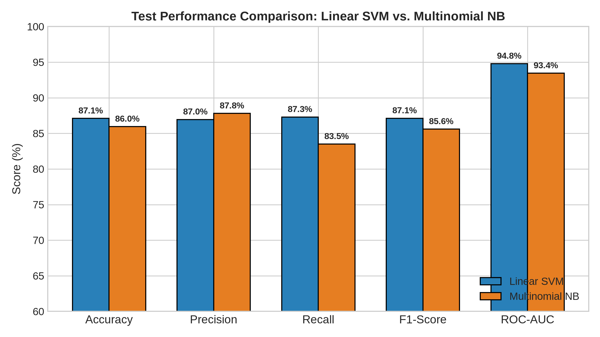
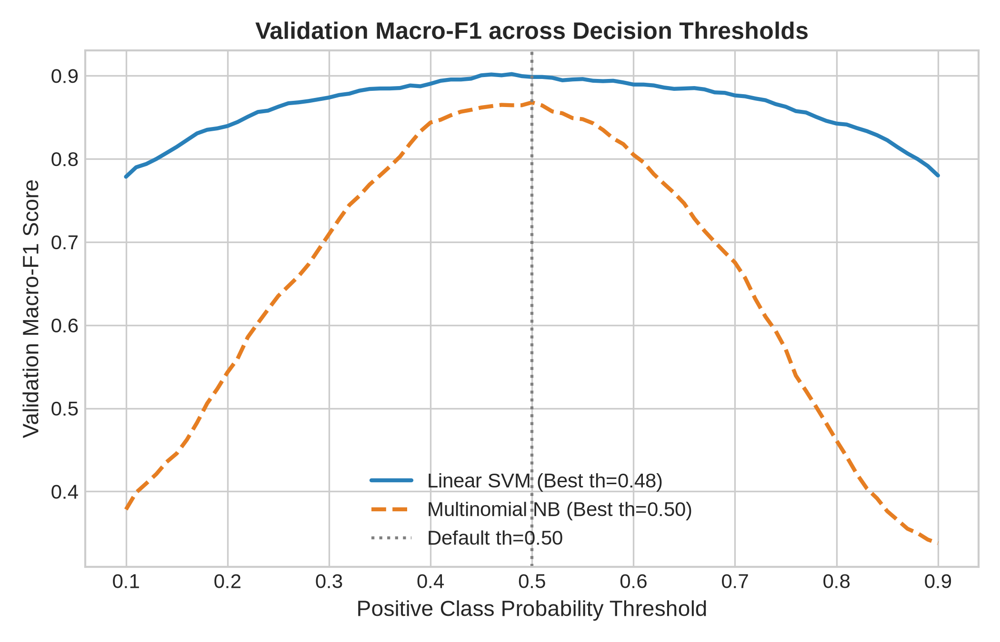
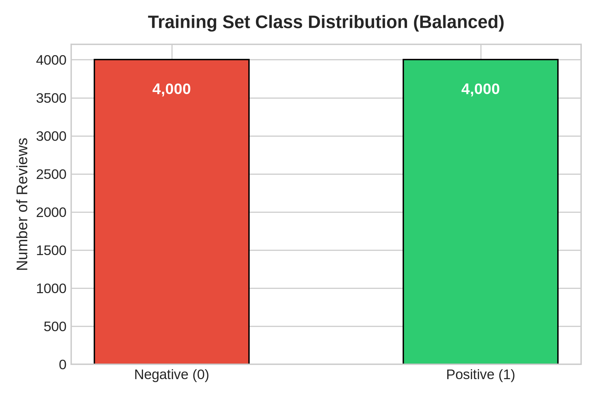
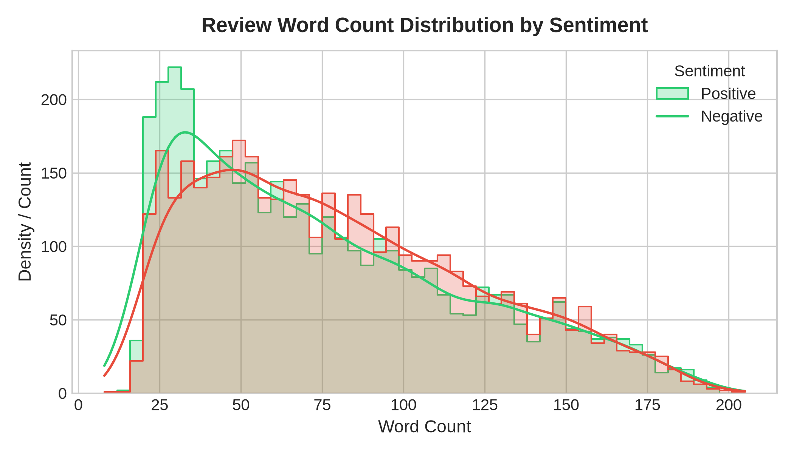
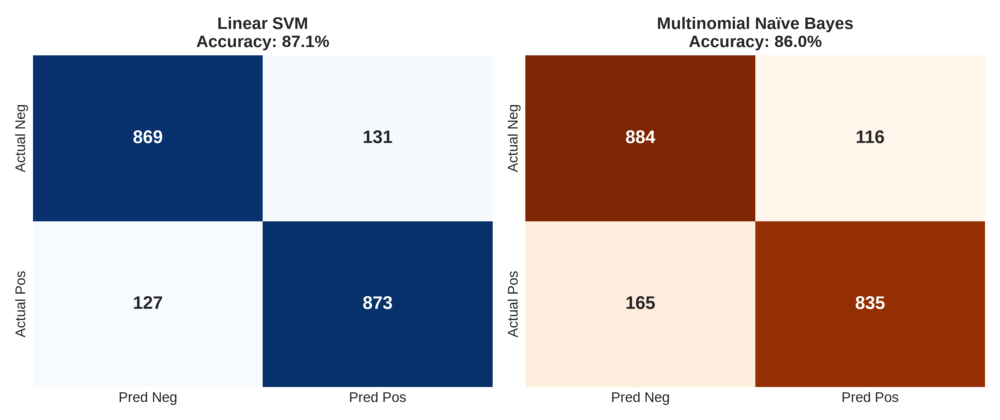
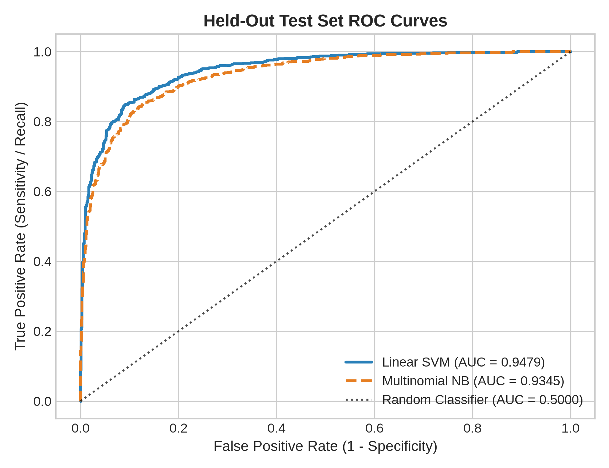
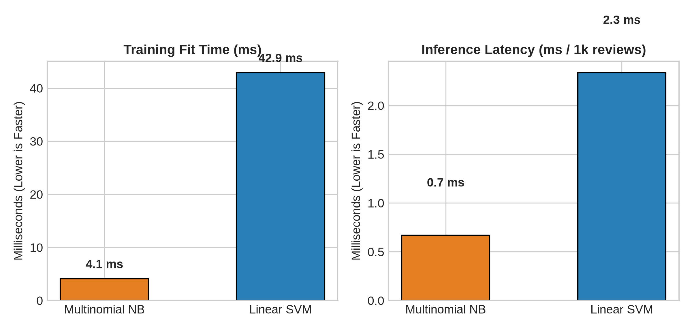
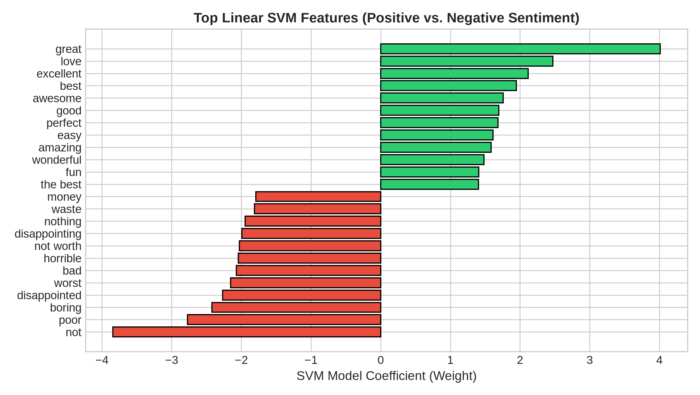

# Amazon Review Sentiment Analysis


A complete machine-learning project that compares **Linear Support Vector Machine (SVM)** and **Multinomial Naive Bayes** classifiers for binary sentiment analysis of Amazon product reviews.

The project uses TF-IDF text features and a balanced dataset of **12,000 Amazon reviews** to classify each review as:

- `1` — Positive sentiment
- `0` — Negative sentiment

It includes a full training pipeline, validation-based hyperparameter tuning, threshold optimization, probability calibration, held-out test evaluation, model interpretability, and visual reports.

---

## Table of Contents

- [Project Overview](#project-overview)
- [Results at a Glance](#results-at-a-glance)
- [Methodology](#methodology)
- [Exploratory Data Analysis](#exploratory-data-analysis)
- [Model Comparison](#model-comparison)
- [Model Interpretability](#model-interpretability)
- [Dataset](#dataset)
- [Project Structure](#project-structure)
- [Installation](#installation)
- [How to Run](#how-to-run)
- [Making a Prediction](#making-a-prediction)
- [Technical Details](#technical-details)
- [Key Takeaways](#key-takeaways)
- [Limitations and Future Work](#limitations-and-future-work)

---

## Project Overview

Customer reviews contain useful information about product quality, customer satisfaction, and buying decisions. This project automatically predicts the sentiment of a review using text-classification techniques.

The implementation compares two established models:

1. **Linear SVM** — finds a separating hyperplane in high-dimensional TF-IDF feature space.
2. **Multinomial Naive Bayes** — uses word-feature probabilities and Bayesian classification assumptions.

Both models receive the same cleaned text and TF-IDF representation. This keeps the comparison fair and focuses the evaluation on model behavior rather than differences in preprocessing.

The repository contains:

- A reproducible Python pipeline in [`pipeline.py`](pipeline.py)
- A complete documented notebook in [`Amazon_SVM_NB.ipynb`](Amazon_SVM_NB.ipynb)
- Pre-split training, validation, and test CSV files
- Generated plots and evaluation metrics

---

## Results at a Glance

The following results were measured on the held-out test set of **2,000 reviews**.

| Metric | Linear SVM | Multinomial Naive Bayes |
|---|---:|---:|
| Accuracy | **87.10%** | 85.95% |
| Positive precision | 86.95% | **87.80%** |
| Positive recall | **87.30%** | 83.50% |
| Positive F1-score | **87.13%** | 85.60% |
| Macro-F1 | **87.10%** | 85.94% |
| ROC-AUC | **94.79%** | 93.45% |
| Tuned-threshold Macro-F1 | 86.95% | 85.94% |
| Optimal positive threshold | 0.48 | 0.50 |
| Fit time | 42.91 ms | **4.09 ms** |
| Inference latency | 2.34 ms / 1k reviews | **0.67 ms / 1k reviews** |

### Overall conclusion

The **Linear SVM achieved the stronger predictive performance**:

- It achieved the highest accuracy, recall, F1-score, macro-F1, and ROC-AUC.
- It was stronger at detecting the positive class.
- It also produced the more interpretable feature coefficients.

The **Multinomial Naive Bayes model was substantially faster**:

- It trained and inferred much faster than the SVM.
- It achieved slightly higher positive precision.
- It may be preferable when training speed, memory use, or a simple probabilistic baseline is more important than maximum accuracy.

Timing values vary between machines and runs. They are useful for relative comparison but should not be treated as fixed hardware benchmarks.

<p align="center">
  
</p>

The performance comparison shows that SVM leads across accuracy, recall, F1-score, and ROC-AUC, while the two models are closer on precision.

---

## Methodology

The pipeline follows this workflow:

```text
Raw review text
      |
      v
Lowercase and clean text
      |
      v
Expand contractions and preserve negations
      |
      v
Remove HTML, URLs, digits, and punctuation
      |
      v
TF-IDF unigram and bigram features
      |
      v
Validation hyperparameter tuning
      |
      v
Train final models
      |
      v
Optional SVM probability calibration
      |
      v
Threshold tuning and held-out test evaluation
```

### 1. Dataset loading

The prepared CSV files are loaded directly. If they are not present, the script expects an Amazon Polarity parquet file at `/tmp/amazon_test.parquet`. The pipeline combines review titles and review content, balances the positive and negative classes, and creates:

- 8,000 training reviews
- 2,000 validation reviews
- 2,000 test reviews

### 2. Text cleaning

The `clean_text()` function performs:

- Lowercasing
- Contraction expansion, such as `won't` → `will not`
- Expansion of negation forms such as `n't` → ` not`
- HTML tag removal
- URL removal
- Removal of characters that are not English alphabetic letters
- Whitespace normalization

Negations are intentionally preserved instead of removing stop words. Words such as `not`, `never`, and `no` can change the meaning of a review and are therefore important sentiment features.

### 3. TF-IDF vectorization

The text is converted into a TF-IDF matrix using:

```python
TfidfVectorizer(
    ngram_range=(1, 2),
    max_features=25000,
    min_df=2,
    sublinear_tf=True
)
```

This configuration:

- Uses individual words and adjacent word pairs
- Limits the vocabulary to 25,000 features
- Ignores terms appearing in fewer than two reviews
- Applies sublinear term-frequency scaling

The vectorizer is fitted **only on the training data**. Validation and test text are transformed using the same learned vocabulary, preventing test-data leakage.

### 4. Hyperparameter tuning

Hyperparameters are selected using Macro-F1 on the validation set:

| Model | Parameter | Values evaluated | Result |
|---|---|---|---|
| Linear SVM | `C` | `0.01, 0.1, 0.5, 1.0, 2.0, 5.0` | Selected from validation Macro-F1 |
| Multinomial Naive Bayes | `alpha` | `0.01, 0.1, 0.5, 1.0, 2.0` | Selected from validation Macro-F1 |

Macro-F1 gives equal importance to both classes, making it appropriate for balanced sentiment classification.

### 5. SVM probability calibration

`LinearSVC` produces decision scores rather than reliable probability estimates. The pipeline wraps it with `CalibratedClassifierCV` using:

- 5-fold cross-validation
- Sigmoid calibration

This allows probability-based comparisons and ROC-AUC/decision-threshold analysis for both models.

### 6. Threshold optimization

Instead of assuming that `0.50` is always the best positive-class threshold, the pipeline evaluates thresholds from `0.10` to `0.90` on the validation set.

- Multinomial Naive Bayes: best threshold `0.50`
- Linear SVM: best threshold `0.48`

The selected thresholds are used for tuned test-set predictions. The default `0.50` threshold is still used for the standard test metrics shown in the main comparison.

<p align="center">
  
</p>

The sweep shows how Macro-F1 changes as the positive-class probability threshold changes. The vertical dotted line represents the conventional `0.50` threshold.

---

## Exploratory Data Analysis

### Balanced class distribution

The training set contains 4,000 positive and 4,000 negative reviews.

<p align="center">
  
</p>

The balanced distribution means that accuracy is meaningful for this dataset. It also avoids a majority-class baseline that could look artificially accurate.

### Review length distribution

The review-length plot compares word counts across positive and negative reviews.

<p align="center">
  
</p>

Most reviews form a short-to-medium-length distribution, although both classes contain longer outliers. Review length alone is not modeled as a separate feature; the distribution is included here to provide context about the dataset.

---

## Model Comparison

### Confusion matrices

<p align="center">
  
</p>

The confusion matrices show true negatives and true positives on the diagonal and classification errors on the off-diagonal cells.

- **Linear SVM accuracy:** 87.1%
- **Multinomial NB accuracy:** 85.95%

The SVM made fewer errors overall in this run and recovered more positive reviews. Naive Bayes achieved slightly better positive precision, meaning that a smaller proportion of its predicted positive reviews were false positives.

### ROC curves

<p align="center">
  
</p>

The ROC curve measures the trade-off between true-positive rate and false-positive rate as the decision threshold changes:

- Linear SVM ROC-AUC: **0.9479**
- Multinomial NB ROC-AUC: **0.9345**

An ROC-AUC closer to `1.0` indicates better ranking of positive reviews above negative reviews. The SVM's larger area indicates stronger class separation on the test set.

### Training and inference speed

<p align="center">
  
</p>

Naive Bayes was faster in both stages:

- **Fit time:** 4.09 ms for Naive Bayes versus 42.91 ms for SVM
- **Inference latency:** 0.67 ms versus 2.34 ms per 1,000 reviews

These measurements exclude calibration overhead from the displayed fit-time comparison and depend on machine, library versions, CPU load, and execution environment.

---

## Model Interpretability

<p align="center">
  
</p>

Linear SVM coefficients indicate how strongly a TF-IDF unigram or bigram pushes a prediction toward one class:

- **Green bars / positive coefficients** increase the predicted positive sentiment score.
- **Red bars / negative coefficients** decrease the positive sentiment score and push a review toward negative sentiment.

The chart focuses on the 12 strongest features in each direction. This makes the linear model easier to audit than a fully opaque classifier: reviewers can inspect which phrases appear to influence predictions.

Coefficients reveal association with training outcomes, not necessarily causal meaning. Short, context-dependent phrases can also capture dataset artifacts rather than general sentiment rules.

---

## Dataset

The project uses balanced samples from the Amazon Review Polarity dataset.

| Partition | Positive | Negative | Total |
|---|---:|---:|---:|
| Training | 4,000 | 4,000 | 8,000 |
| Validation | 1,000 | 1,000 | 2,000 |
| Test | 1,000 | 1,000 | 2,000 |
| **Total** | **6,000** | **6,000** | **12,000** |

Each dataset file contains a header and two columns:

```text
text,label
"The product worked exactly as described.",1
"This arrived damaged and stopped working.",0
```

- `text`: combined title and review content
- `label`: binary sentiment label

### Dataset files

```text
Dataset/
├── train_sample.csv
├── val_sample.csv
└── test_sample.csv
```

The validation set is used for hyperparameter and decision-threshold tuning. The test set is not used for tuning and is evaluated only once for the final report.

---

## Project Structure

```text
Amazon-Review-Sentiment-Analysis/
├── Amazon_SVM_NB.ipynb
├── pipeline.py
├── README.md
├── Dataset/
│   ├── train_sample.csv
│   ├── val_sample.csv
│   └── test_sample.csv
└── Results/
    ├── class_distribution.png
    ├── confusion_matrices.png
    ├── feature_importance.png
    ├── latency_comparison.png
    ├── metrics_summary.csv
    ├── model_comparison.png
    ├── review_length_dist.png
    ├── roc_curves.png
    └── threshold_tuning.png
```

---

## Installation

### Requirements

- Python 3.10 or newer
- NumPy
- pandas
- scikit-learn
- matplotlib
- seaborn

### Clone the repository

```bash
git clone https://github.com/YEsh-DEV/Amazon-Review-Sentiment-Analysis.git
cd Amazon-Review-Sentiment-Analysis
```

### Create a virtual environment

```bash
python -m venv .venv
source .venv/bin/activate
```

On Windows:

```bash
.venv\Scripts\activate
```

### Install dependencies

```bash
python -m pip install numpy pandas scikit-learn matplotlib seaborn jupyter
```

The repository's prepared CSV files allow the pipeline to run without downloading the original dataset.

---

## How to Run

### Run the complete Python pipeline

From the repository root:

```bash
python pipeline.py
```

The script will:

1. Load the prepared data
2. Generate exploratory-analysis plots
3. Clean and vectorize the reviews
4. Tune both models on the validation set
5. Calibrate SVM probabilities
6. Optimize decision thresholds
7. Evaluate both models on the test set
8. Save plots and metrics in `Results/`

### Run the notebook

```bash
jupyter notebook Amazon_SVM_NB.ipynb
```

The notebook presents the same workflow interactively, from setup and EDA through live predictions.

### Generated metrics

After running the pipeline, machine-readable metrics are available at:

```text
Results/metrics_summary.csv
```

The script may overwrite the existing PNG and CSV reports in `Results/`.

---

## Making a Prediction

The notebook includes an interactive `predict_sentiment(review_text: str)` function for custom reviews.

Example:

```python
predict_sentiment(
    "Amazing sound quality and the battery lasts for days!"
)
```

Conceptually, the prediction process is:

```python
cleaned = clean_text(review_text)
vector = vectorizer.transform([cleaned])

svm_probability = cal_svm.predict_proba(vector)[0][1]
nb_probability = nb.predict_proba(vector)[0][1]

svm_label = "Positive" if svm_probability >= best_svm_th else "Negative"
nb_label = "Positive" if nb_probability >= best_nb_th else "Negative"
```

Example review types:

- `"Amazing quality and excellent customer support."` → usually positive
- `"Terrible product. It broke after two days."` → usually negative
- `"It is not bad for the price."` → tests negation handling
- `"Do not waste your money on this."` → tests negative recommendation language

This project predicts sentiment only. It does not assign emotions, severity, intent, or business priority.

---

## Technical Details

### Evaluation metrics

For positive sentiment class `1`:

- **Precision** — of reviews predicted positive, how many were truly positive
- **Recall** — of truly positive reviews, how many were found
- **F1-score** — harmonic mean of positive precision and recall
- **Macro-F1** — mean F1 across positive and negative classes
- **Accuracy** — fraction of all test reviews classified correctly
- **ROC-AUC** — ability to rank positive reviews above negative reviews across thresholds

### Reproducibility

The pipeline sets a random state of `42` for:

- Balanced dataset sampling
- Dataset partition shuffling
- Linear SVM training

Exact timing values remain machine-dependent.

### Why no stopword removal?

Many common text pipelines remove stop words. This project does not remove them because negations are significant:

- `"good"` has positive meaning
- `"not good"` has negative meaning
- `"bad"` has negative meaning
- `"not bad"` can have positive or comparatively favorable meaning

Preserving negation words helps the model distinguish these phrases.

---

## Key Takeaways

- The Linear SVM was the better classifier for predictive accuracy and ranking.
- TF-IDF with unigrams and bigrams captures useful sentiment phrases.
- Validation tuning is used to avoid selecting hyperparameters from the test set.
- SVM probability calibration enables ROC-AUC and threshold evaluation.
- Naive Bayes is a strong, lightweight baseline with much lower fit and inference cost.
- Feature-coefficient output provides interpretable evidence for SVM predictions.
- Random execution timing should not be used as the sole model-selection criterion.

---

## Limitations and Future Work

Possible limitations and next improvements include:

- The dataset is a balanced sample rather than the full Amazon Review Polarity corpus.
- TF-IDF is bag-of-ngram based and does not explicitly model semantic similarity.
- Sarcasm, mixed sentiment, and context spanning distant words remain difficult.
- Misspellings, slang, emojis, and multilingual reviews are not explicitly modeled.
- Word-level analysis may miss customer intent and fine-grained aspect sentiment.
- Evaluation currently uses one fixed held-out test split.

Potential extensions include:

- Cross-validation instead of a single split
- Character-level or word-level n-grams
- Logistic regression or a linear SVM baseline comparison
- Distilled transformer models for stronger semantic understanding
- Aspect-based sentiment analysis
- Production API or interactive web interface
- Confidence calibration and uncertainty reporting
- Dataset-drift and performance-monitoring analysis

---

## License

Add your preferred license before publishing or distributing the project publicly.
